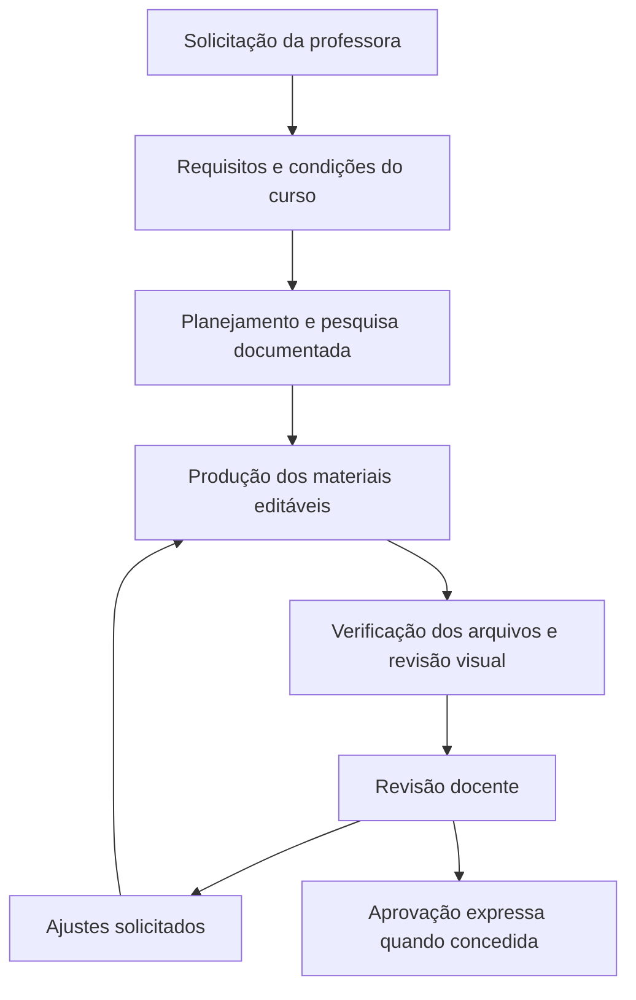

# Agente de IA para criação de cursos em saúde

Um projeto de integração entre experiência clínica, planejamento educacional e inteligência artificial.

**Autora e responsável pela concepção:** Lucyana Teodoro de Oliveira.  
**Situação:** fluxo aplicado a uma primeira produção; materiais didáticos sujeitos à revisão docente.  
**Tecnologias utilizadas no projeto:** Codex, Markdown, Python, python-pptx e Microsoft PowerPoint.

## O problema

Preparar um curso em saúde exige conciliar objetivos de aprendizagem, pesquisa científica, tempo disponível, condições de prática e materiais que possam ser revisados. Essas informações precisam permanecer organizadas durante as alterações do projeto.

## A solução construída

Configurei um assistente no ambiente do Codex, orientado por documentos de requisitos, regras de pesquisa, perfil profissional e registros de decisões. O assistente trabalha quando solicitado e prepara entregas para minha revisão.

O projeto opera neste ambiente de trabalho. Não há aplicativo independente, execução em segundo plano ou integração clínica com pacientes.

## Minha participação e a assistência de IA

Defini o propósito, o público, as condições de realização e os critérios de qualidade. Orientei as decisões e avaliei os materiais produzidos. Ao identificar limitações na primeira apresentação, solicitei uma reformulação do conteúdo e do design.

A organização documental, a pesquisa, o código e os materiais foram desenvolvidos com assistência de IA. A implementação assistida não é apresentada como programação integralmente escrita por mim. As decisões finais e a avaliação docente permanecem humanas.

## Primeira aplicação

**Curso:** mobilização, transferências e prevenção de quedas.  
**Formato:** presencial, três horas incluindo prática.  
**Público:** aproximadamente 15 estudantes da saúde, principalmente Fisioterapia e Enfermagem, em diferentes níveis de formação.  
**Condições informadas:** uma professora, macas, cadeiras e espaço para movimentação.

A apresentação foi organizada em um percurso principal de 42 slides, com 33 slides de complemento e 14 de referências e créditos. Os 47 slides de consulta permanecem disponíveis no editor e ocultos na apresentação normal.

Também foram produzidos cronograma docente, checklists e casos fictícios com respostas de apoio. Os arquivos completos do curso não integram este repositório de portfólio.

## O que foi verificado

Os registros locais da versão reformulada, de 08/11/2026, documentam:

| Verificação | Resultado registrado |
| --- | --- |
| Arquivo PowerPoint | PPTX criado, reaberto e exportado pelo Microsoft PowerPoint |
| Estrutura | 89 slides e 89 notas do apresentador |
| Elementos editáveis | Texto nativo, quatro tabelas nativas e um gráfico editável |
| Consulta | PDF exportado com 89 páginas |
| Revisão visual | Pranchas cobrindo todos os slides e inspeção ampliada de slides selecionados |
| Pesquisa | Registro de busca, bibliografia e 25 fichas de fontes com alcance de acesso documentado |

Esses dados descrevem entregas e verificações técnicas. Não demonstram eficácia pedagógica ou clínica.

## Aprendizados

- Requisitos gerais precisam ser acompanhados de critérios concretos para cada entrega.
- Conteúdo principal e material de aprofundamento exigem organização compatível com o tempo de aula.
- Um arquivo editável precisa ser aberto e conferido; o roteiro em texto não substitui o PPTX.
- Verificações estruturais e inspeção visual ajudam a identificar problemas diferentes.
- Aprovação deve ser registrada por decisão da professora, sem ser presumida após gerar arquivos.

## Limites e próximos passos

Ainda não foram medidos tempo economizado, aprendizagem dos participantes ou efeitos na assistência. O curso não é apresentado como aplicado ou aprovado. A publicação de materiais didáticos completos depende de revisão e autorização específicas.

Este repositório documenta o projeto e oferece exemplos de sua organização. Não contém uma instalação completa do agente nem recomendações para atendimento individual.

## Exemplos de documentação

- [Briefing de uma edição](exemplos/briefing.md)
- [Critérios de qualidade](exemplos/criterios-qualidade.md)

[Voltar ao perfil](../../README.md)
